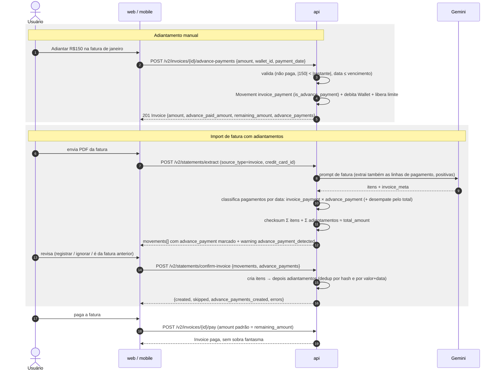

# AYD-007: Adiantamento de fatura de cartão de crédito

> Análise & Design cross-repo. Define o mecanismo de **`InvoiceAdvancePayment`** (pagar
> parte de uma `Invoice` antes de quitá-la) e o ajuste no import de fatura (AYD-004) para
> reconhecer e registrar adiantamentos que o banco lista na própria fatura.
>
> `AYD-005` neste doc é sempre o de **planejamentos (orçado × realizado)**, onde vive o recorte
> canônico de "realizado"; o ID está duplicado com o de transferência interna no `manifest`.

## Objetivo

Atende **RF-06** (controlar `CreditCard` e `Invoice`) e **RF-07** (importar fatura). Hoje a
`Invoice` aceita **um único pagamento**, que a quita: `POST /v2/invoices/:id/pay` marca
`is_paid`, debita a `Wallet` e, se o valor for menor que o total, joga o restante para a
fatura seguinte (`invoice_remainder`). Não há como registrar que o usuário **já pagou parte
da fatura** durante o ciclo, coisa que todo banco permite e que o Mercado Pago, por exemplo,
lista na própria fatura.

Resultado esperado:
1. O usuário registra um ou mais adiantamentos numa `Invoice` aberta. Cada um debita a
   `Wallet` na data e libera limite do cartão, e a fatura continua aberta pelo **restante**.
2. Na quitação, o valor sugerido é o restante, e o cálculo da sobra que vai para a fatura
   seguinte considera o que já foi adiantado.
3. O import de fatura distingue o pagamento **da fatura anterior** (que não entra, como hoje)
   do adiantamento **desta fatura** (que vira `InvoiceAdvancePayment`), e o total do app passa
   a bater com o total do documento.

## Evidência — fatura Mercado Pago, jan/2026

Teste funcional do import (AYD-004) na `develop`, nov/2026. Resumo impresso na fatura:

| Linha do resumo | Valor |
|---|---|
| Total da fatura de dezembro | R$ 178,44 |
| Consumos de 30/12 a 29/01 | R$ 1.503,90 |
| Pagamentos e créditos devolvidos | − R$ 377,44 |
| **Total a pagar** (vence 04/02/2026) | **R$ 1.304,90** |

Os R$ 377,44 são três linhas em "Movimentações na fatura":

| Data | Descrição | Valor | O que é |
|---|---|---|---|
| 30/12 | Pagamento da fatura de dezembro/2025 | 178,44 | pagamento da fatura **anterior** (vencida em 04/01). Anula a linha "Total da fatura de dezembro" |
| 11/01 | Pagamento da fatura de janeiro/2026 | 150,00 | **adiantamento desta fatura** |
| 16/01 | Pagamento da fatura de janeiro/2026 | 49,00 | **adiantamento desta fatura** |

A guarda do AYD-004 (§"Itens que não pertencem à fatura") marca as três como
`invoice_payment`. As compras somam corretamente − R$ 1.503,90, mas o app passa a dizer que a
fatura é R$ 199,00 maior que a do banco. O `total_amount_mismatch` dispara (esperado
−1.304,90, detectado −1.503,90). Se o usuário pagar os R$ 1.304,90 no app, o `pay` trata o
pagamento como parcial e **joga R$ 199,00 para fevereiro**, uma dívida que não existe.

Não foi erro do modelo: a extração estava certa. Falta ao domínio o conceito de adiantamento.

## Estado atual (api) — o que o mecanismo precisa contornar

| Ponto | Comportamento hoje | Impacto |
|---|---|---|
| `Invoice.Pay` (`invoice_usecase.go`) | Um pagamento por fatura; `amount` entre `invoice.Amount` e 0; sobra `invoice.Amount − paid` vai para a fatura seguinte | Precisa operar sobre o **restante** |
| `buildMovementWithAmount` | O `Movement` de pagamento usa **`ID = invoice.ID`** | Hoje só cabe um pagamento por fatura. Este é o pagamento de **quitação** |
| `FindInvoicePaymentByInvoiceID` / `DeleteByInvoiceID` (`movement_repository.go`) | Filtram por `invoice_id` + `type_payment = invoice_payment` e supõem um único registro | Com adiantamentos, o `revert-pay` apagaria os adiantamentos junto |
| `FindByInvoiceID` / `RecalculateInvoice` | Já excluem `invoice_payment` da soma da fatura | Sem impacto: adiantamento não altera `invoice.amount` |
| Recorte de "realizado" (AYD-003/AYD-005), agente, planejamentos | Excluem `type_payment = invoice_payment` | Se o adiantamento mantiver esse tipo, fica fora dos agregados sem mudança |
| web/mobile — lista de fluxo de caixa | Escondem o `Movement` real de `invoice_payment` da fatura e desenham uma linha **virtual** com `invoice.amount` | Esconderiam os adiantamentos e mostrariam o total bruto como "a pagar" |

## Repos afetados e papéis

| Repo | Papel nesta feature | SPEC gerada |
|------|---------------------|-------------|
| api | Dono do mecanismo: endpoints de adiantamento, campos derivados na `Invoice`, `pay`/`revert-pay` sobre o restante, classificação das linhas de pagamento no `/extract` e registro dos adiantamentos no `confirm-invoice` | a criar (SPEC@api) |
| web | Detalhe da fatura (adiantado/restante, lista, adiantar, desfazer), modal de pagamento sugerindo o restante, fluxo de caixa sem esconder adiantamentos, revisão do import com o grupo "Adiantamentos desta fatura" | a criar (SPEC@web) |
| mobile | O mesmo do web: detalhe da fatura, pagamento, `movements-view`, revisão do import | a criar (SPEC@mobile) |

## Decisões-chave

| # | Decisão | Por quê |
|---|---|---|
| 1 | **Adiantamento é um `Movement` com `type_payment: invoice_payment`**, `is_paid: true`, ligado à fatura por `invoice_id`, com **ID próprio**. Sem tipo novo. | Todo recorte que exclui pagamento de fatura (realizado AYD-003/AYD-005, agente, planejamentos, gráficos por categoria dos clientes) já cobre o adiantamento sem mudança. Um `type_payment` novo vazaria como despesa em cada um desses filtros. |
| 2 | **Quitação e adiantamento são distinguíveis no contrato** pelo campo `is_advance_payment` no `Movement`. | Os clientes precisam saber qual `invoice_payment` é a linha da fatura e qual é um débito real a exibir. O mecanismo interno (manter `id == invoice_id` para a quitação, coluna explícita etc.) é escolha da SPEC@api, mas a quitação **continua única por fatura**. |
| 3 | **`invoice.amount` continua bruto** (soma das compras da competência). Entram dois campos derivados: `advance_paid_amount` e `remaining_amount`. | "Faturas por cartão" (AYD-003) e o limite consumido seguem a competência; o adiantamento muda **quanto falta pagar**, não **quanto se gastou**. |
| 4 | **Só em fatura não paga, e sempre menor que o restante** (em módulo). Adiantar o restante inteiro é quitar: usa-se `pay`, que já aceita `payment_date` anterior ao vencimento. | Mantém uma única forma de quitar e evita fatura "paga por adiantamentos" sem quitação. Pagar mais que o restante (saldo credor) fica fora de escopo (ver questões em aberto). |
| 5 | **Efeitos imediatos na data do adiantamento:** debita a `Wallet` e **libera limite** do cartão no valor adiantado. A fatura continua aberta. | É o que o banco faz: o limite volta na hora do pagamento. RN-02 passa a ler "a `Invoice` afeta o `Balance` quando paga, **no todo ou em adiantamentos**". |
| 6 | **`pay` opera sobre o restante:** `amount` padrão = `remaining_amount`; válido entre `remaining_amount` e 0; a sobra para a fatura seguinte é `remaining_amount − pago`. | Sem isso, o caso do Mercado Pago vira a dívida fantasma de R$ 199,00 descrita na evidência. |
| 7 | **`revert-pay` desfaz só a quitação.** Adiantamentos se desfazem um a um pelo `DELETE` próprio, e só com a fatura não paga (desfaz-se primeiro a quitação). | Desfazer a quitação não deve apagar pagamentos que de fato aconteceram, e a ordem fixa evita recalcular a sobra da fatura seguinte com uma base que mudou. |
| 8 | **Import: a linha de pagamento é classificada por regra determinística de data**, com o checksum do total como desempate. O adiantamento detectado vira `exclusion_reason: "advance_payment"` no `/extract` e é registrado pelo `confirm-invoice` num campo próprio (`advance_payments[]`), nunca como item da fatura. | Nome do mês na descrição não serve: há bancos que nomeiam a fatura pelo mês do fechamento (Mercado Pago) e outros pelo do vencimento. A regra de data mais o total do documento resolvem os dois casos conhecidos sem depender do modelo. |

## Contratos (fonte da verdade)

### `POST /v2/invoices/{id}/advance-payments` *(novo)*

```jsonc
// req
{
  "amount": 150.00,               // obrigatório; aceita positivo ou negativo, normalizado para negativo (como o /pay)
  "wallet_id": "uuid",            // opcional; padrão = invoice.wallet_id (carteira default do cartão)
  "payment_date": "2026-01-11"    // opcional; padrão = hoje (fuso do usuário). Não pode ser posterior a due_date
}
// res 201 — a Invoice atualizada (shape abaixo), incluindo advance_payments[]
```

**Erros** (contrato de erro global, `error.type` quando houver):

| Situação | HTTP | `error.type` |
|---|---|---|
| Fatura não encontrada / de outro usuário | 404 | — |
| Fatura já paga | 409 | `invoice_already_paid` |
| `amount` = 0 ou ausente | 422 | `invalid_payment_amount` |
| \|`amount`\| ≥ \|`remaining_amount`\| (quitaria a fatura) | 422 | `advance_payment_settles_invoice` |
| `payment_date` posterior a `due_date` | 422 | `advance_payment_after_due_date` |
| `Wallet` não encontrada | 404 | — |

### `DELETE /v2/invoices/{id}/advance-payments/{movement_id}` *(novo)*

Desfaz um adiantamento: devolve o valor à `Wallet`, volta a consumir o limite e apaga o
`Movement`. `res 200` traz a `Invoice` atualizada.

| Situação | HTTP | `error.type` |
|---|---|---|
| Fatura paga (desfazer a quitação primeiro) | 409 | `invoice_already_paid` |
| `movement_id` não é adiantamento desta fatura | 404 | `advance_payment_not_found` |

### `Invoice` — campos novos (aditivos)

Em **todas** as respostas que devolvem `Invoice` (`GET /v2/invoices/{id}`, `/date`, `/detailed`,
`pay`, `revert-pay`, `recalculate` e os dois endpoints acima):

```jsonc
{
  "amount": -1503.90,                // inalterado: bruto, soma das compras da competência
  "advance_paid_amount": -199.00,    // (novo) soma dos adiantamentos; 0 quando não há; mesmo sinal de amount
  "remaining_amount": -1304.90,      // (novo) amount − advance_paid_amount; o que falta pagar
  // só em GET /v2/invoices/{id}, /detailed e nas respostas dos endpoints de adiantamento:
  "advance_payments": [              // (novo) ordem por payment_date
    { "id": "uuid",                  // id do Movement
      "payment_date": "2026-01-11",
      "amount": -150.00,
      "wallet_id": "uuid",
      "description": "Adiantamento da fatura - Mercado Pago" }
  ]
}
```

Depois de quitada, `remaining_amount` continua sendo o valor que a quitação cobriu (não vai a
zero): é a base do cálculo da sobra e o valor que os clientes exibem na linha da fatura.

### `POST /v2/invoices/{id}/pay` — semântica alterada, payload inalterado

`req { wallet_id, payment_date?, amount? }`, como hoje. Mudam três coisas:
- `amount` ausente ⇒ paga `remaining_amount` (hoje: `amount`).
- Validação: `remaining_amount ≤ amount < 0` (hoje: contra `amount`). Fora disso, 422
  `invalid_payment_amount`, como hoje.
- Sobra levada à fatura seguinte = `remaining_amount − amount pago`.

### `POST /v2/invoices/{id}/revert-pay` — semântica alterada

Desfaz **só a quitação**: estorna o valor dela na `Wallet` e no limite e remove a sobra lançada
na fatura seguinte, calculada sobre `remaining_amount`. Os adiantamentos permanecem.

### `Movement` — campo novo (aditivo)

```jsonc
{ "type_payment": "invoice_payment", "invoice_id": "uuid", "is_advance_payment": true }
```

`is_advance_payment` só aparece (`true`) em adiantamentos. Ausente/`false` em `invoice_payment`
indica a quitação. Os clientes usam o campo para decidir o que esconder no fluxo de caixa (ver
"Clientes").

### Ajuste no import de fatura (delta sobre AYD-004)

**`POST /v2/statements/extract`:**

- **Camada 1 (prompt), revisada:** o modelo passa a **extrair todas as linhas de pagamento**
  ("Pagamento da fatura…", "PAGAMENTO ON LINE", "PAGTO FATURA"…), sempre com **valor
  positivo**, em vez de omiti-las. Também não extrai linhas do bloco de resumo ("Total da
  fatura anterior", "Saldo anterior", "Pagamentos e créditos"). Omitir não é mais desejável,
  porque um adiantamento omitido desaparece sem deixar rastro.
- **Camada 2 (guarda), estendida:** toda linha reconhecida por `IsInvoicePaymentDescription`
  tem o sinal normalizado para positivo e é classificada:

  | Classe | `exclusion_reason` | Regra |
  |---|---|---|
  | Pagamento da fatura anterior | `invoice_payment` (inalterado) | data ≤ vencimento da fatura **anterior** à fatura alvo |
  | Adiantamento desta fatura | `advance_payment` *(novo)* | vencimento da anterior < data ≤ `period_end` da fatura alvo |

  - **Datas de referência:** a fatura alvo é a mesma da regra de competência futura
    (`ResolveTargetInvoicePeriodEnd`, pelo cartão). O vencimento da anterior é o `due_date`
    da fatura que fecha no dia anterior ao `period_start` da alvo.
  - **Sem `credit_card_id`:** usa `invoice_meta.closing_date` como `period_end` e
    `invoice_meta.due_date − 1 mês` como vencimento da anterior.
  - **Sem nenhum dos dois:** tudo vira `invoice_payment`, o comportamento atual.
  - **Desempate pelo checksum:** se `invoice_meta.total_amount` existe, a classificação
    padrão **não** reconcilia com ele e "todas as linhas como `invoice_payment`"
    reconcilia, vale a segunda. Cobre o pagamento atrasado da fatura anterior, que a regra
    de data confundiria com adiantamento.
  - O item continua em `movements[]` com `excluded: true`, como os demais marcados.
- **Camada 3 (checksum), reformulada:** `Σ itens não marcados + Σ adiantamentos ≈
  invoice_meta.total_amount` (tolerância atual). Na fatura do Mercado Pago: −1.503,90 + 199,00
  = −1.304,90. Em faturas sem adiantamento a fórmula se reduz à atual.
- **Warning novo:** `{ "type": "advance_payment_detected" }` quando ≥ 1 item vier com
  `exclusion_reason: "advance_payment"`.

```jsonc
{
  "date": "2026-01-11",
  "description": "Pagamento da fatura de janeiro/2026",
  "amount": 150.00,
  "type_payment": "credit_card",
  "excluded": true,
  "exclusion_reason": "advance_payment"   // (novo)
}
```

**`POST /v2/statements/confirm-invoice`:**

```jsonc
// req — campo novo, opcional
{
  "credit_card_id": "uuid",
  "invoice_id": "uuid|null",
  "movements": [ /* inalterado; itens advance_payment continuam sendo pulados como excluded */ ],
  "advance_payments": [                  // (novo) o que o usuário decidiu registrar
    { "date": "2026-01-11", "amount": 150.00,
      "description": "Pagamento da fatura de janeiro/2026",
      "wallet_id": "uuid|null" }         // padrão = carteira default do cartão
  ]
}
// res — campo novo
{ "created": 47, "skipped": 3, "advance_payments_created": 2, "errors": [] }
```

Semântica:
- Os adiantamentos são processados **depois** dos itens, para que `remaining_amount` já inclua
  as compras importadas. A fatura alvo é `invoice_id`, quando enviado, ou a mesma resolvida
  para os itens.
- Cada adiantamento segue as regras do `POST .../advance-payments`. Uma violação vira entrada
  em `errors` e não aborta o import. Exceção: fatura alvo já paga mantém o 422 atual do
  `confirm-invoice`.
- **Dedup** (conta em `skipped`):
  - hash de idempotência do AYD-004 (escopo `credit_card_id`), gravado no `Movement` do
    adiantamento, o que torna o reimport idempotente;
  - adiantamento já existente na fatura alvo com o mesmo valor e data a até 3 dias, para
    quando o usuário já o registrou à mão.

**O que não muda no import:** `invoice_payment` continua nunca entrando, e o
`confirm-invoice` continua reaplicando a guarda sobre `movements[]`. Um cliente antigo, que
não envia `advance_payments`, segue funcionando: os adiantamentos só não são registrados.

## Modelo de domínio afetado

- **`InvoiceAdvancePayment`** — termo novo no GLO. Não é entidade nem tabela própria: é um
  `Movement` com `type_payment = invoice_payment`, `is_paid = true`, `invoice_id` e
  `credit_card_id` da fatura, `wallet_id` de quem pagou, categoria padrão de cartão e
  `is_advance_payment = true`.
- **`Invoice`** ganha os derivados `advance_paid_amount` e `remaining_amount`. Nada novo é
  gravado em `invoices`: `amount`, `is_paid`, `payment_date` e `wallet_id` mantêm o sentido de
  hoje, e `payment_date`/`wallet_id` continuam sendo os da **quitação**.
- **Invariantes** (entram nas invariantes de aceite da api, SPEC-008@api):
  - `advance_paid_amount = Σ amount` dos adiantamentos da fatura;
  - `remaining_amount = amount − advance_paid_amount`, com `remaining_amount < 0` enquanto a
    fatura não for quitada e tiver adiantamento;
  - limite usado do cartão = Σ `remaining_amount` das faturas não pagas (+ sobras lançadas);
  - `Balance` da `Wallet` reflete cada adiantamento na data dele.

## Clientes (web e mobile)

1. **Detalhe da fatura:** mostra Total (`amount`), Adiantado (`advance_paid_amount`) e
   Restante (`remaining_amount`), mais a lista de `advance_payments` com ação de desfazer
   (desabilitada se a fatura estiver paga). A ação **"Adiantar pagamento"** abre um modal com
   valor (< restante), carteira (padrão do cartão) e data.
2. **Modal de pagamento:** valor sugerido = `remaining_amount`. O texto de "pagamento parcial"
   passa a falar do restante.
3. **Fluxo de caixa** (`movements-view.ts`@mobile, lista de transações@web): **não esconder**
   `invoice_payment` com `is_advance_payment: true`, que são débitos reais da `Wallet`. A linha
   virtual da fatura passa a mostrar `remaining_amount`. Gráficos por categoria não mudam,
   porque já descartam `invoice_payment`.
4. **Revisão do import:**
   - itens `advance_payment` vão para um grupo **"Adiantamentos desta fatura"**, cada um
     com a escolha *registrar adiantamento* (padrão) ou *ignorar*, e a ação *"é pagamento da
     fatura anterior"*, que muda o motivo para `invoice_payment`;
   - o resumo mostra Compras, Adiantamentos e **A pagar**, este reconciliado com
     `invoice_meta.total_amount`;
   - o confirm envia em `advance_payments[]` os que ficaram marcados para registrar;
   - itens `advance_payment` não somam como despesa nem como entrada no resumo de itens.

## Fluxo cross-repo



## Implementação por repo (pontos de entrada)

- **api:** `internal/usecase/invoice_usecase.go` (novo `AdvancePayment`/`RevertAdvancePayment`;
  `Pay`, `handleRemainder` e `RevertPayment` sobre o restante);
  `internal/infrastructure/repository/movement_repository.go` (quitação e adiantamentos
  separados em `FindInvoicePaymentByInvoiceID`/`DeleteByInvoiceID`; soma dos adiantamentos);
  `internal/infrastructure/api/invoice_api.go` (rotas novas); `internal/domain/invoice.go`
  (derivados); `internal/domain/statement.go` e `internal/usecase/statement_usecase.go`
  (classificação, checksum, `advance_payments[]`);
  `internal/infrastructure/gateway/gemini_vision_gateway.go` (prompts de fatura e auto).
- **web:** detalhe/pagamento de fatura (`lib/api/invoices.ts`, modais de fatura), lista de
  transações do dashboard, `components/statement-import/*` e `hooks/use-statement-import.ts`.
- **mobile:** `src/lib/api/invoices.ts`, tela de detalhe do cartão/fatura,
  `src/lib/dashboard/movements-view.ts`, `src/screens/StatementReviewScreen.tsx`.

## Plano faseado

| Fase | Repo | Entrega | Depende de |
|---|---|---|---|
| 1 | api | Mecanismo: endpoints de adiantamento, derivados na `Invoice`, `pay`/`revert-pay` sobre o restante, `is_advance_payment` | — |
| 2 | api | Import: prompt extrai pagamentos, classificação, checksum, `advance_payments[]` no `confirm-invoice` | 1 |
| 3 | web, mobile | Exibição correta (restante, fluxo de caixa) + adiantar/desfazer manual | 1 |
| 4 | web, mobile | Revisão do import com o grupo de adiantamentos | 2 |

As fases 2 e 3 são independentes. O ajuste do import (2 + 4) é pequeno: reaproveita a
resolução de fatura alvo, o hash e a mecânica `excluded`/`exclusion_reason` que já existem.

## Riscos e mitigações

| Risco | Mitigação |
|---|---|
| Pagamento **atrasado** da fatura anterior classificado como adiantamento | Desempate pelo checksum do total; a UI permite trocar o motivo para "fatura anterior" |
| Banco que não lista adiantamentos na fatura, ou modelo que os omite | Checksum continua avisando (`total_amount_mismatch`); o usuário pode registrar o adiantamento à mão no detalhe da fatura |
| Cliente antigo esconde os adiantamentos no fluxo de caixa (filtra todo `invoice_payment` da fatura) | Campo aditivo; enquanto o cliente não atualiza, o adiantamento só deixa de aparecer na lista, sem erro de saldo (o `Balance` vem da api) |
| Duplicidade com o **extrato bancário**: o Pix de R$150 ao cartão importado também como despesa da `Wallet` | Já acontece hoje com a quitação; fica registrado como questão em aberto, não resolvido aqui |
| Agregados que usam `invoice.amount` como "a pagar" | `amount` mantém o sentido bruto; o que for "a pagar" migra para `remaining_amount`, e cada SPEC lista seus pontos de uso |

## Decisões relacionadas

- **AYD-004** — o import de fatura. Este AYD revisa a camada 1 (prompt) e estende as camadas 2
  e 3 de §"Itens que não pertencem à fatura"; o AYD-004 aponta para cá.
- **AYD-003 / AYD-005 (planejamentos)** — o recorte de "realizado" exclui `invoice_payment`, e
  por isso o adiantamento mantém esse tipo (Decisão 1).
- **Nenhum ADR aplicável:** não há serviço nem integração nova.

## Fora de escopo / questões em aberto

- [ ] **Saldo credor:** pagar mais que o restante, ou adiantar numa fatura que ainda não tem
      compras suficientes. O Mercado Pago aceita; aqui é rejeitado
      (`advance_payment_settles_invoice`). Decidir se vira crédito na fatura seguinte.
- [ ] **Pagamento ao cartão no extrato bancário:** o import de `Statement` traz o Pix/boleto
      pago ao cartão como despesa da `Wallet`, duplicando quitação e adiantamentos. Precisa de
      sugestão de vínculo (como `recurrence_id`) no caminho statement.
- [ ] **Fatura anterior parcialmente paga** (sobra rolada pelo banco): a linha de resumo
      "Total da fatura anterior" diferente do pagamento dela não é tratada. O app modela isso
      via `invoice_remainder`, mas o import não reconcilia.
- [ ] **Adiantamento com fatura já quitada no app** (o usuário quitou e depois importou): hoje
      o `confirm-invoice` aborta com 422 para fatura paga. Manter.
- **Não confundir com "antecipação de parcelas"** (quitar parcelas futuras de uma compra com
  desconto): conceito bancário distinto, fora deste AYD.
